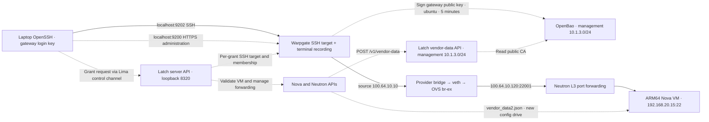

# Local server and network-device access POC

This repository builds a real OpenStack cloud to test laptop access through a Warpgate SSH gateway, Neutron floating-IP port forwarding and an SSH certificate issued by OpenBao. It uses a centralized **neutron-l3-agent**, ML2/Open vSwitch and an actual Nova/Ubuntu VM. Change-management and external identity-provider integrations are omitted. See [the infrastructure diagram](INFRASTRUCTURE.md) or the [documentation index](docs/README.md).

## What runs where

The default `lima` backend creates an ARM64 Ubuntu 24.04 Linux VM named `latch-arm64`, using Apple's hardware virtualization. OpenStack runs directly in that Linux VM. A rootful Docker daemon in the same VM runs separate containers for Warpgate, OpenBao and the vendor-data API. Provisioning also enables the server grant API:

| Service | Responsibility |
| --- | --- |
| `openbao` | Persistent SSH certificate authority; laptop API port 8200 |
| `latch-api` | Dynamic vendor-data application; Linux-host loopback port 8300, not forwarded to the laptop |
| `server-api` | Authenticated server grants, OpenStack access control and Warpgate admission; Linux-host loopback port 8320, no laptop forward |
| `warpgate` | SSH targets and terminal recordings; laptop HTTPS port 9200 and SSH port 9202; provider IP `100.64.10.10` |

The laptop uses standard OpenSSH. Warpgate terminates client SSH, authorizes a named SSH target, and creates a separate certificate-authenticated SSH connection to the VM. No agent is installed on the target. Warpgate 0.30.2 provides these SSH and recording features under its Apache 2.0 license, without a paid Boundary edition. Lima forwards only the configured service ports to laptop loopback. Docker operations performed by `./lab` target the daemon inside Lima, independently of Docker Desktop and its environment variables. A temporary `provider-probe` container is used for the negative connectivity test.

The OpenStack controller, network-node and compute roles share one Linux VM. DevStack `stable/2025.2` installs Keystone, Glance, Placement, Nova API/scheduler/conductor/compute/metadata, Neutron API/RPC, OVS/DHCP/L3/metadata agents, MySQL and RabbitMQ. No Horizon or Cinder is installed. The network-node role is an actual L3 agent in `agent_mode=legacy`; it is not a separate network-node VM.

| Mac | Linux OpenStack host | ARM64 tenant VM |
| --- | --- | --- |
| M1/M2 | Hardware accelerated | QEMU software emulation |
| M3 or later, macOS 15+ | Hardware accelerated | KVM if a real ARM virtual CPU can be initialized; otherwise QEMU |

`LAB_ACCEL=auto` selects the tenant accelerator after a Linux KVM capability test. `tcg` explicitly selects software emulation. `kvm` requires working KVM and fails rather than silently falling back. ARM64 QEMU can still boot slowly on M1/M2, but the OpenStack host no longer incurs x86 CPU translation.

The previous Docker Desktop/QEMU architecture is available as `LAB_BACKEND=legacy`. It uses the `compose.legacy.yaml`, x86 disks under `.state/`, and Docker Desktop volumes. The Lima backend uses `compose.lima.yaml`, laptop state under `.state/lima/`, and new service volumes inside the Lima VM. Existing x86 disks and CA data are retained; they are not automatically imported into the ARM64 environment.

The optional [device access foundation](docs/guides/device-access.md) adds separate OpenLDAP, LDAP-specific OpenBao and authenticated device API containers on `10.1.3.0/24`. `./lab network-up` starts these services together with freeRouter and tac_plus-ng; the existing VM certificate path remains independent.

The optional [open source network-device lab](docs/guides/network-device-lab.md) adds native ARM64 freeRouter and tac_plus-ng containers. Run `./lab network-up`, then `./lab network-verify` to exercise recorded Warpgate SSH, OpenBao temporary LDAP passwords, and TACACS+ command authorization. Use `./lab device-grant --device freertr --role readonly --ttl 300` followed by `./lab device-connect --grant GRANT_UUID` to connect; `readonly` permits operational diagnostics and outbound connections; `operator` adds all configuration-mode commands and saves; `admin` permits all commands. Operators can change AAA configuration, so this is not a strict security boundary from admin. Inventory and caller permissions control which roles can be issued. Routed-subnet checks passed for connectivity, isolation, all three roles, recordings and explicit revocation. The latest complete suite stopped at its host-key test baseline; see the [validation status](docs/guides/network-device-lab.md#validation-status).

## Networks and access path

| Network | Subnet | Addresses and purpose |
| --- | --- | --- |
| Gateway ingress | `10.1.1.0/24` | Warpgate `.2`, Docker gateway `.254` |
| Service management | `10.1.3.0/24` | Warpgate `.10`, TACACS+ `.21`, device-router `.253`, OpenBao, LDAP and Latch APIs; Docker gateway `.254` |
| Device management | `10.1.4.0/24` | freeRouter `.20`; device-router `.1`; routed from service management without NAT |
| OpenStack management | `172.20.2.0/24` | Host `.15` on a persistent Linux dummy interface |
| OpenStack external/provider | `100.64.10.0/24` | OVS gateway `.1`, gateway `.10`, floating IP `.120`, Docker gateway `.254` |
| Tenant | `192.168.20.0/24` | Neutron router `.1`, Nova VM `.15` |

The optional device lab uses a separate `10.1.4.0/24` management network for
freeRouter at `.20`. Warpgate reaches it through `device-router`
(`10.1.3.253` / `10.1.4.1`), while TACACS+ stays on service management at
`10.1.3.21`. The lab router permits only SSH from Warpgate and TACACS+ from the
device, plus replies, without NAT. See the [device lab guide](docs/guides/network-device-lab.md#logical-architecture)
for routes and validation status. Warpgate has no direct device-subnet attachment.

The requested `172.20.2.0/24` address space remains the OpenStack management segment. Lima uses its own additional NAT interface for Internet access and host management; this segment no longer supplies the old QEMU SLIRP gateway/DNS. `./lab ssh` uses Lima's managed SSH connection.



The OpenStack external/provider network is private and external to the tenant network; it is not Internet-facing. Docker allocates provider addresses from `.0/27`, reserves `.1`, and uses `.2` for the temporary diagnostic source. Neutron allocates `.100–.249`. TCP `100.64.10.120:22001` forwards to `192.168.20.15:22`; the floating IP is not directly associated with the VM port.

A veth pair connects Docker's `latch-provider` Linux bridge to OVS `br-ex` on the same Linux host. The gateway has connected ingress/management/provider routes and an explicit route to device management through `10.1.3.253`, with no default route and no direct tenant route. Its `NET_ADMIN` capability removes Docker's default route and installs the device route. The target security group accepts SSH only from `100.64.10.10/32`. Laptop users reach the gateway through loopback forwarding.

OVS supplies Layer 2 connectivity between VM ports, router interfaces and the provider network. The Neutron L3 agent supplies routing and NAT in Linux namespaces. This lab needs both; OVN is disabled.

## Requirements

- Apple Silicon Mac, macOS 13.5 or later; nested acceleration requires supported M3-or-later hardware and macOS 15+.
- Lima (`brew install lima`), Python 3.10+, OpenSSH and `tar`. Docker Desktop is not required for the Lima backend.
- Default Linux VM allocation: 8 GiB RAM, six CPUs and an 80 GiB sparse disk. Leave memory for macOS; a 16 GiB or larger Mac is preferable for this complete cloud.
- Internet access to Ubuntu cloud images/APT, Docker Hub, GHCR, OpenDev, PyPI and Warpgate releases.

The stable OpenStack branch, current Ubuntu cloud images and packages are moving upstream inputs. This is a disposable connectivity lab, not a production cloud or a performance benchmark.

## Build and run

```sh
brew install lima
cp .env.example .env
./lab doctor
./lab up
./lab install
./lab logs
```

`up` creates or starts the Lima VM, copies the lab sources, and starts the supporting containers. `install` starts a background systemd job that installs OpenStack, selects tenant acceleration and connects the provider bridges. Wait until the log prints `Installation complete`. Ctrl-C stops log following without stopping installation. Container health alone does not establish OpenStack readiness.

Then run:

```sh
./lab status
./lab provision
./lab verify
./server-grant --ttl 300
./server-connect --grant GRANT_UUID
```

`provision` creates the provider/tenant networks, router, security group, ARM64 UEFI Ubuntu image, VM and floating IP. It deploys the server API with trusted inventory and retires the old shared gateway login. Forwarding is opened on demand by a server grant. It waits up to 30 minutes for Nova ACTIVE; ACTIVE precedes SSH readiness. `verify` checks:

1. Live Neutron L3, OVS and DHCP agents and a router namespace.
2. No direct gateway route to the tenant VM.
3. Successful gateway connectivity through Neutron forwarding, followed by rejection of provider source `100.64.10.2`.
4. Laptop SSH through a Warpgate SSH target using a gateway-held OpenBao certificate, with the target reporting source `100.64.10.10`.
5. Rejection of unauthorized signing principals, excessive certificate lifetimes, unsigned keys, expired certificates and the wrong SSH login principal. A final valid login confirms connectivity remains intact.

`server-grant` issues a grant separately and prints its ID. Pass that ID to
`./server-connect --grant GRANT_UUID` to open an interactive `ubuntu` shell.
Connecting requires an existing grant; it never issues one. Type `exit` to leave;
the grant remains valid until expiry or explicit revocation. `./lab ssh` opens a
`stack` shell with sudo access on the OpenStack host.

Server access is the shared term for physical hosts and VMs. The current
inventory/network adapter supports OpenStack VMs; physical-host adapters remain
future work.

Configure resources and ports in `.env` before creating the VM. Lima settings are creation-time choices; the CLI rejects changed settings for an existing VM. Set `LAB_ACCEL=tcg` before creation to test the M1/M2 tenant mode on newer hardware.

## SSH user certificates

OpenBao 2.7.2 stores its Raft data and SSH CA in the Linux VM's `openbao` Docker volume. The laptop key authenticates to Warpgate, independently of the target VM. Warpgate requests a five-minute `ubuntu` certificate from OpenBao for its outbound SSH connection. The target authentication key stays at the gateway; the CA private key stays in OpenBao. Warpgate verifies the VM's SSH host key and records terminal sessions in persistent storage. The laptop key is `.state/lima/gateway_ed25519`; Latch creates a unique Warpgate user, role and SSH target for each server grant. View sessions and replay recordings in the HTTPS administration interface at `https://localhost:9200/@warpgate/admin` (local self-signed TLS).

```sh
./lab recordings  # list recorded sessions; replay from the administration UI
```

The administration UI path is `/@warpgate/admin`; an HTTP 401 at `/` is expected.

`./lab certificate` remains an operator inspection command for the separate restricted lab signing role. Its certificates are not how the laptop authenticates to Warpgate.

New Lima tenants receive platform configuration from Latch API through Nova DynamicJSON. Nova sends instance context to `POST /v1/vendor-data`; Latch reads OpenBao's public SSH CA endpoint without a signing token and returns cloud-config for CA trust, SSH policy and local NTP. Nova writes `openstack/latest/vendor_data2.json` into the config drive. No user data or CA private key is sent to the VM. Existing VMs retain their original config drive; provisioning does not replace them or refresh configuration on ordinary reboot. The [cutover and recovery procedure](docs/guides/vendor-data-cutover.md) describes a separately approved replacement while retaining the original VM and disk.

The tenant has 1 GiB RAM and an 8 GB disk. Cloud-init installs `TrustedUserCAKeys` and disables authorized-key, password and keyboard-interactive login. The locked-password `latch-other` account exists only to test principal mismatch; the signing role allows only `ubuntu`.

Development credentials:

| Service | Credentials |
| --- | --- |
| Warpgate, `https://localhost:9200/@warpgate/admin` | `admin`; generated password in `.state/lima/warpgate/admin-password` (Lima backend) |
| OpenBao, `http://127.0.0.1:8200` | Userpass `latch` / `latch-local-only` |
| OpenStack | Admin password `latch-openstack` |

The operator signing role permits `ubuntu` certificates with a 15-minute maximum. The gateway uses a separate restricted signing identity/role for five-minute target certificates and session attribution. OpenBao signing permission and gateway target authorization are distinct controls.

**Local lab only:** OpenBao and Latch use HTTP on trusted local networks; Warpgate administration uses self-signed HTTPS. OpenBao automatically unseals using root-only recovery material in `/opt/latch/bao/init.json` in its persistent volume. This is local recovery convenience, not production secret custody. Certificate expiry prevents new logins; it does not terminate established sessions.

## Server grants and revocation

```sh
./server-grant --ttl 300
./server-status
./server-connect --grant GRANT_UUID
./server-revoke --grant GRANT_UUID
```

Replace `GRANT_UUID` with the ID printed by `server-grant`. Add
`--server SERVER_UUID` when selecting among authorized inventory servers.
`./lab grant` creates the default grant; `./lab revoke` revokes the current grant.
Without `--grant`, `server-status` and `server-revoke` use that remembered current grant.
`./server-connect` requires `--grant`; it never creates a grant. Disconnecting
does not revoke it. Root commands also work as `./lab server-grant`,
`./lab server-connect`, `./lab server-status` and `./lab server-revoke`.

The API closes a revoked or expired grant's active sessions and removes its
gateway admission. Disabled targets can remain until the final grant closes
so another grant keeps its shared endpoint host-key pin. It releases its owned
Neutron forwarding only after the
last grant for that VM is cleaned up. Durable cleanup retries survive API
restart; `cleanup_pending` means closure has not completed. Expiring membership
blocks new gateway authorization, but active termination requires the API
worker to run. Server readonly/operator/admin roles remain proposed; current server
grants provide the existing `ubuntu` shell.

See the [full server access workflow](docs/guides/access-workflows.md#server-access),
[command reference](docs/reference/commands.md#server-grants) and
[API reference with ReDoc access](docs/reference/api.md).

## Inspect and troubleshoot

Inside `./lab ssh`:

```sh
cat /opt/latch/acceleration.json
source /opt/stack/devstack/openrc admin admin
/opt/stack/data/venv/bin/openstack network agent list
/opt/stack/data/venv/bin/openstack server show latch-vm
/opt/stack/data/venv/bin/openstack console log show latch-vm
sudo virsh list --all
sudo ip netns list
sudo ovs-vsctl show
sudo journalctl -u devstack@q-l3 -n 100
```

From the laptop:

```sh
limactl list latch-arm64
limactl shell latch-arm64 -- sudo docker compose -f /home/stack/latch/compose.lima.yaml ps
limactl shell latch-arm64 -- sudo docker compose -f /home/stack/latch/compose.lima.yaml logs warpgate openbao latch-api
limactl shell latch-arm64 -- sudo docker compose -f /home/stack/latch/compose.lima.yaml exec warpgate ip route
```

Latch API can be inspected from the Linux host, without publishing it on the laptop:

```sh
limactl shell latch-arm64 -- curl -fsS http://127.0.0.1:8300/health/ready
limactl shell latch-arm64 -- sudo docker compose -f /home/stack/latch/compose.lima.yaml logs latch-api
```

Inside a newly created DynamicJSON tenant, inspect the config-drive response:

```sh
sudo mkdir -p /mnt/config-drive
sudo mount -o ro /dev/disk/by-label/config-2 /mnt/config-drive
sudo cat /mnt/config-drive/openstack/latest/vendor_data2.json
sudo cloud-init status --long
ssh-keygen -lf /etc/ssh/latch-user-ca.pub
sudo umount /mnt/config-drive
```

The API uses Nova's `cloud-init` target name and returns a JSON string, producing a single `cloud-init` key in `vendor_data2.json`. It ignores tenant metadata as configuration policy. Delivery failure is fatal to a new instance build; existing tenant SSH does not depend on the vendor-data application remaining available. The separate server API coordinates new grants and active-session cleanup. The initial POC trusts the Linux host and management network; add TLS and Nova-compatible service authentication before exposing this application more broadly.

For compatibility with this Nova version's config-drive builder, providers are `StaticJSON,DynamicJSON` with no static file path. The legacy `vendor_data.json` contains only `{}`; Latch supplies the CA and platform policy exclusively through `vendor_data2.json`. Compute and metadata services read separate configuration files (`nova-cpu.conf` and `nova.conf`), so both need the provider settings.

Plain `docker compose` in this directory still describes the legacy Docker Desktop lab. Use the explicit Lima commands above to inspect the ARM64 services.

If installation fails, inspect `./lab logs` and `/opt/stack/logs/stack.sh.log`, correct the error and rerun `./lab install`. Systemd rejects a concurrent installation. Provisioning reuses named resources but is not transactional; partial failures can require repairing an incomplete resource inside the disposable cloud. If the negative connectivity check fails, inspect security groups and NAT behavior before accepting the access restriction. If Nova is ACTIVE but SSH times out, inspect the console and cloud-init logs.

## Stop, restart and legacy rollback

```sh
./lab down
./lab up
./lab provision
./lab verify
```

`down` removes supporting containers without deleting their volumes, then stops the Lima VM cleanly. OpenStack disks, service volumes and CA remain inside Lima; laptop keys remain in `.state/lima/`.

After an installed host starts, `up` restores the provider uplink and runs `guest/resume.sh`. It starts the installed OpenStack services, waits for API responses, live Nova/Neutron agents and the existing router’s namespace, and starts an existing `latch-vm` if it is SHUTOFF. It checks that the tenant’s libvirt domain is running before reporting readiness. If APIs respond but network agents remain stale or the router namespace is missing after 90 seconds, it restarts Neutron RPC followed by the installed L3, DHCP and OVS agents once; readiness still has a ten-minute deadline. Boot configuration orders services after the management address and their database/broker/OVS dependencies, retries failed DevStack processes, and enables Nova guest resume. An ERROR tenant causes recovery to fail for investigation. SSH readiness is established by `verify`. When trusted VM inventory is present,
`up` also restores the server API after OpenStack resumes, allowing its persisted
grant expiry and cleanup work to continue.

Warpgate database, host keys and recordings persist in its own volume. The retired Boundary volumes are retained for rollback; do not delete them or run Boundary concurrently on provider address `100.64.10.10`. Re-run `provision` and `verify` after restart to check configuration and access.

Short-lived certificates require synchronized clocks. The OpenStack host runs Chrony on `100.64.10.1:123/UDP`, and tenant cloud-init points systemd-timesyncd to that local source with a 16–32 second poll interval. The tenant needs no Internet NTP access. This corrects nested guest clock drift after laptop sleep; without it, SSH can reject a freshly issued certificate as “not yet valid.” The host follows upstream NTP and can temporarily serve its own clock at stratum 10 while offline. Installation and provisioning configure the host service; existing tenants created before this fix need the same timesyncd configuration applied inside the VM because cloud-init does not rerun when reprovisioning an existing server.

To return to the retained x86 environment after stopping Lima:

```sh
LAB_BACKEND=legacy ./lab up
LAB_BACKEND=legacy ./lab status
```

The legacy backend needs Docker Desktop/Engine with Compose v2 and at least 8 GiB allocated to Docker. It adds an x86 QEMU runner with its own Linux guest. Its defaults are four CPUs, 6 GiB guest memory and a 64 GB disk. Its `.state/` keys and Docker Desktop volumes are separate from Lima. Latch API/DynamicJSON provisioning and API-managed server grants are supported only on the Lima backend; the retained legacy backend has no Latch service or validated route to it. Stop one backend before starting the other on the same laptop ports.

Deleting a Lima VM destroys the OpenStack disk and its Docker volumes, including the CA. Back up the VM disk and `.state/lima/` together before any deliberate reset. A new CA requires reprovisioning target trust. Never commit `.state/` or `.env`.

## Repository layout and maintenance

See the [repository layout reference](docs/reference/repository-layout.md) for module responsibilities, Compose profiles and test types, and the [container image/helper map](containers/README.md) for build inputs.

| Path | Purpose |
| --- | --- |
| `lab`, `scripts/lab.py` | Laptop command entry point, lifecycle and connectivity checks |
| `scripts/lima_backend.py` | ARM64 Lima configuration, source synchronization and remote Docker commands |
| `scripts/certificates.py` | Operator key generation and OpenBao certificate inspection |
| `scripts/warpgate.py` | Gateway bootstrap, target authorization and recording/session operations |
| `compose.lima.yaml`, `containers/` | Core service containers inside Lima, including the provisioned server API; optional diagnostic container |
| `compose.lima.yaml` profiles, `scripts/network_integration.py`, `docs/guides/network-device-lab.md` | Optional freeRouter/TACACS+ lab, lifecycle and usage |
| `latch_api/` | Latch application, public-CA client and dynamic vendor-data route |
| `config/openstack/local.conf`, `guest/` | DevStack configuration, provisioning, bridge setup, recovery and validation |
| `compose.legacy.yaml`, `containers/openstack/` | Retained legacy Docker Desktop/QEMU bootstrap; unused by the default backend |
| `tests/` | Offline CLI/configuration/recovery checks and separate certificate integration test |
| `docs/` | [Documentation index](docs/README.md): architecture, guides, reference and historical records |

Run the offline checks from the repository root:

```sh
python3 -m unittest discover -s tests -v
bash -n guest/*.sh containers/*.sh containers/openstack/entrypoint.sh tests/certificates-integration.sh
git diff --check
```

Run the suite in a Python virtual environment with `python3 -m pip install -r latch_api/requirements.txt` to include Latch API contract tests; these skip explicitly when their dependencies are missing. The offline suite requires `jq` for recovery checks; otherwise those tests skip explicitly. Certificate integration skips unless `LATCH_CERTIFICATE_INTEGRATION=1` is set by the integration harness. Offline tests do not install OpenStack or replace `./lab verify`. After lifecycle or networking changes, validate installation/provisioning and repeat `down`, `up`, `provision`, `verify` against the real cloud. Keep generated state, images, private keys and credentials outside version control.

The [access workflow guide](docs/guides/access-workflows.md) explains how users
receive network-device and server access, including network reachability, gateway
admission, target authentication, command permissions, recordings and revocation.

## Verification status

The server naming and explicit-grant CLI update passed **197 offline tests:
196 passed and one integration-only test skipped** on 2026-11-04. A live smoke
test ran the exact root commands: `./server-grant`,
`./server-connect --grant GRANT_UUID` and `./server-revoke --grant GRANT_UUID`.
Actual SSH returned the server hostname, disconnecting left the grant active,
and explicit revoke closed it. The full renamed live acceptance suite then passed
at `2026-11-04T15:58:51Z` (`tests/live_server_gateway.py`). It verified API
credentials and inventory policy, two independent certificate-backed SSH grants
sharing one forwarding, API restart with live sessions retained, independent
revocation and reconnection with the surviving grant, replayable recordings,
final-grant network removal, normal active-session expiry and cleanup after a
grant expired during API downtime. Current evidence is in local
`.state/lima/server-verification.json`.

The earlier API-managed OpenStack server acceptance run passed at `2026-11-04T03:19:22Z`
(`tests/live_server_gateway.py`). It exercised rejected missing/incorrect bearer
credentials, unauthorized instances and destination/TTL overrides; two concurrent
certificate-backed SSH grants sharing one forwarding; API restart without losing
grants or sessions; independent revocation with the second grant still admitting
connections; final-grant network removal; replayable recordings; active expiry;
and startup cleanup after expiry during API downtime. Evidence is in local
`.state/lima/vm-verification.json`. The suite cleaned its own grants and network
access. It reset login-protection history only for its deliberately rejected test
identities; global protection remained enabled.

A final `./lab verify` passed ARM64 KVM, live Neutron agents, route isolation,
gateway-only provider access, real certificate SSH, signing-policy limits and
unsigned/wrong-principal/expired-certificate rejection. Recording
`b39f8b73-ae85-4d8a-a72f-73e37a79cc10` replay contained the verification marker.
That baseline offline suite ran **194 tests: 193 passed and one integration-only test
skipped**. Offline coverage includes wrong-pin rejection and cleanup-failure
recovery; the server live run did not repeat device-specific outage testing. Server role
restrictions remain a proposal.

The complete live `./lab network-verify` suite passed on 2026-11-03 local time (`2026-11-04T01:20:28Z`), with all ten checks passing: recorded readonly/operator/admin SSH and role permissions, explicit revoke and active expiry, host-key rejection/recovery, invalid/revoked LDAP credentials, and LDAP/TACACS+ outage fail-closed behavior with recovery. The earlier generic migration preserved existing credentials and data. Evidence is in `.state/lima/network-verification.json`; see the [network-device validation status](docs/guides/network-device-lab.md#validation-status) for recording IDs and precise role-test coverage. Gateway-restart replay passed independently for the prior run’s recordings; this latest suite did not repeat that restart check.

On 2026-11-03, fresh `./lab verify` passed after the generic device-access migration: live Neutron L3/OVS/DHCP agents, ARM64 KVM tenant, gateway route isolation, provider-source rejection, recorded VM SSH, signing limits and unsigned/wrong-principal/expired-certificate rejection. The VM observed gateway source `100.64.10.10`; recording `f61ab311-a4af-41a8-9588-0d318d259fb5` contained the verification marker and was replayable. The earlier live Latch API readiness/POST smoke test on 2026-11-02 returned the unchanged CA fingerprint and rendered CA trust, SSH policy, bootstrap metadata and NTP configuration through the shared renderer. This smoke test did not replace the existing tenant.

The rerun first cleared a pre-existing test-induced block for the lab NAT source `10.1.1.254` through Warpgate's supported admin API; login protection remained enabled with its existing policy. Network-device acceptance is tracked separately in the [current guide](docs/guides/network-device-lab.md#validation-status).

Dynamic vendor-data acceptance completed on 2026-10-30 before the gateway migration. A fresh disposable VM received the correct CA through `vendor_data2.json`, without user data; certificate login and rejection checks passed. Latch/OpenBao outage tests caused fresh builds to fail, while the existing VM retained working SSH. Recovery and a profile revision change proved that new builds fetch fresh configuration and existing config drives retain their snapshot. Disposable resources were removed and the original profile restored. Evidence is in local `.state/dynamic-vm-validation.md`.

The service-management migration preserved CA fingerprint `SHA256:FLZ2zQC5ICf8oDYnHMqMU2nPurJD6OaISF3SWXsbp6I`. The ARM64 OpenStack host and tenant passed the previous Boundary connectivity suite on Apple M4/macOS 15.3.2/Lima 2.2.1, including KVM, provider source rejection, stop/start recovery and NTP correction. These are historical baseline results, not Warpgate acceptance. Physical M1/M2 hardware has not been tested.

On 2026-10-30, `./lab provision` retained primary VM `13fdcc3d-0b86-4cc7-a460-13143ea2267e` and the existing CA. `./lab verify` passed Neutron/network isolation, real gateway SSH, expected provider source and certificate-policy checks. It also decoded a terminal recording and found the verification output in recording `f4781163-da0e-4804-8f88-beafeadfc789`. Subsequent live checks passed unauthorized gateway-user rejection, recording persistence and SSH after container recreation, active-session termination with `./lab revoke`, rejection of new connections while revoked, and restored access with `./lab grant`. The original CA remained unchanged. The offline suite ran 74 tests with one integration-only skip. See [migration acceptance](docs/archive/warpgate-migration.md) and [recorded validation evidence](docs/archive/warpgate-validation.md). The diagrams show the deployed topology.

The certificate integration test can run independently on a Docker engine:

```sh
env -u DOCKER_DEFAULT_PLATFORM docker build -f tests/Dockerfile.certificates -t latch-certificate-test .
env -u DOCKER_DEFAULT_PLATFORM docker run --rm latch-certificate-test
```

## References

- [Lima VZ hardware virtualization](https://lima-vm.io/docs/config/vmtype/vz/)
- [Lima configuration, including nested virtualization](https://github.com/lima-vm/lima/blob/master/templates/default.yaml)
- [DevStack 2025.2 networking](https://docs.openstack.org/devstack/2025.2/networking.html)
- [Neutron floating-IP port forwarding](https://docs.openstack.org/neutron/latest/admin/config-fip-port-forwardings.html)
- [Warpgate SSH targets and OpenBao certificates](https://warpgate.null.page/targets/ssh/)
- [Warpgate session recordings](https://warpgate.null.page/recordings/)
- [Warpgate source and license](https://github.com/warp-tech/warpgate)
- [OpenBao signed SSH certificates](https://openbao.org/docs/secrets/ssh/signed-ssh-certificates/)
