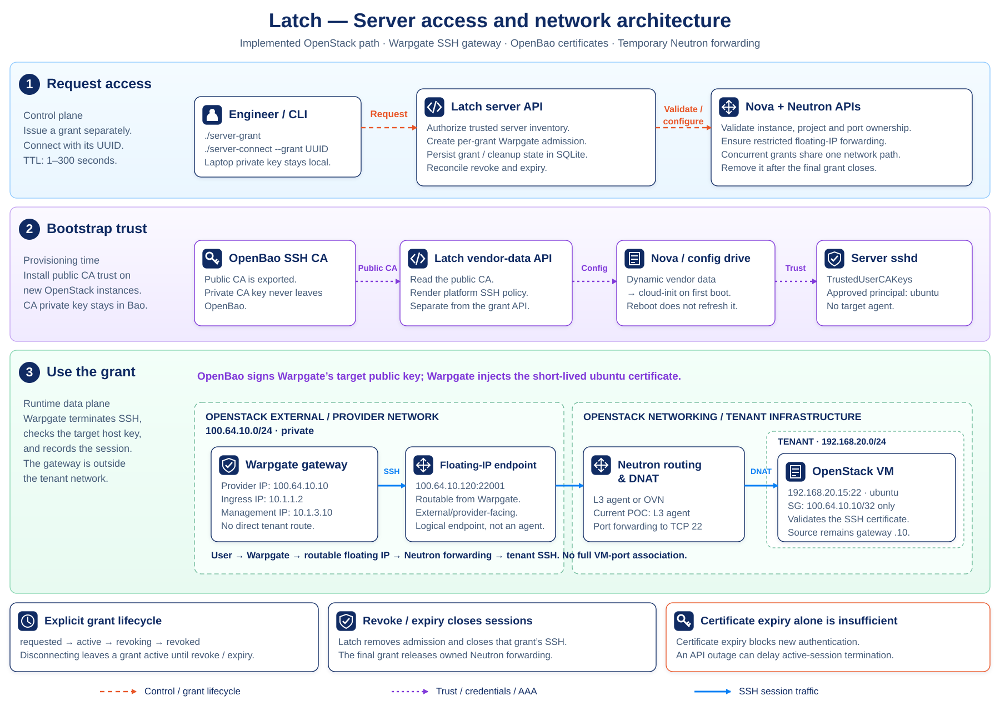
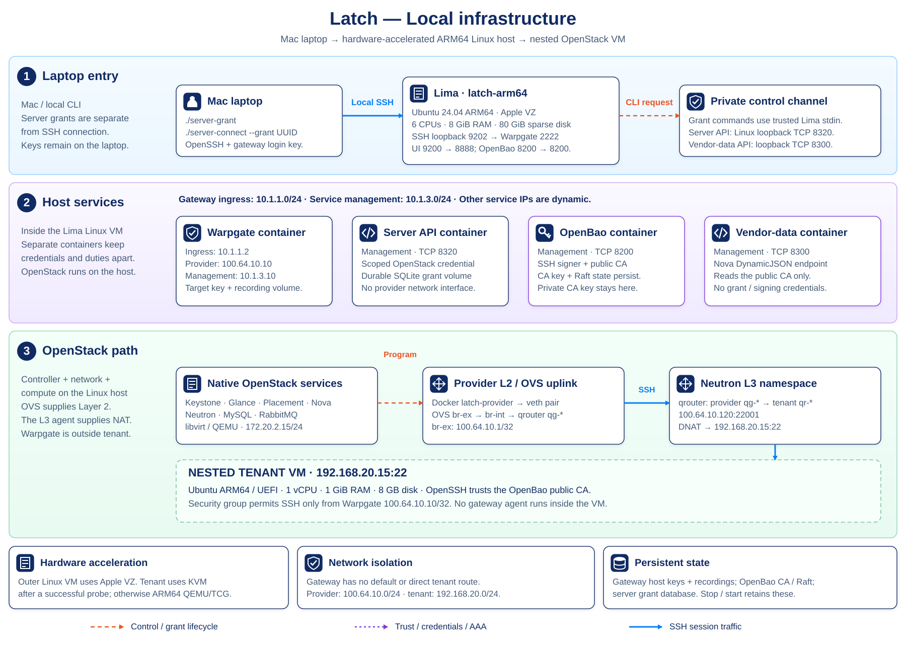
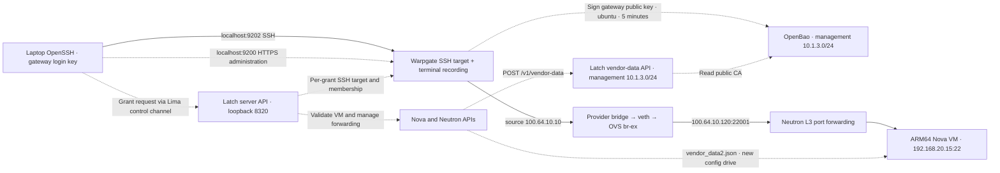
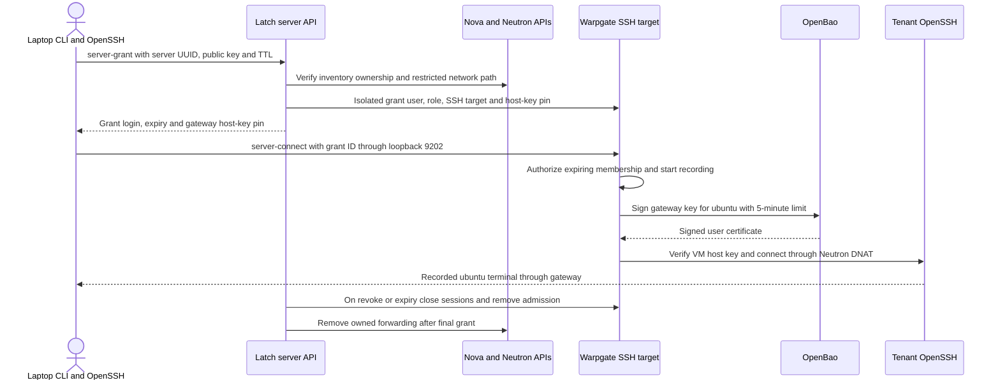
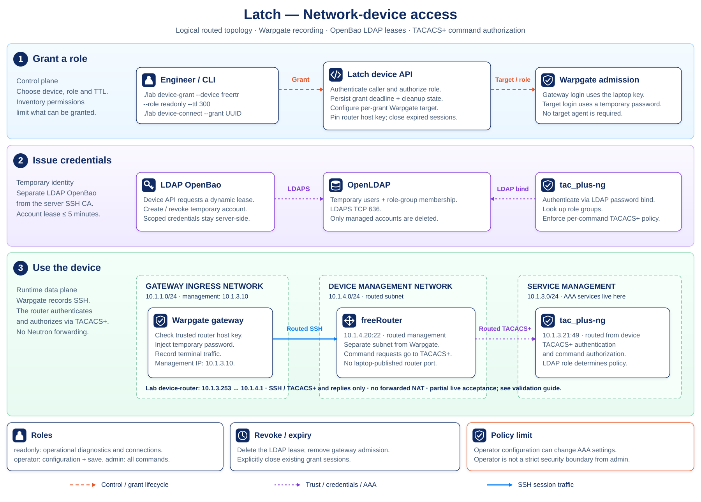

# Infrastructure and access flows

[Documentation index](../README.md) · [Diagram sources](README.md) · [Command reference](../reference/commands.md)

The default Lima backend runs OpenStack directly in a hardware-accelerated ARM64 Ubuntu Linux VM on the Mac. Controller, network-node and compute roles share that VM. The tenant is a second, nested ARM64 VM. Warpgate, OpenBao, the vendor-data API and the server grant API run in four separate containers after provisioning. The APIs have separate credentials and responsibilities. Warpgate replaces the former Boundary controller, worker and PostgreSQL services with an agentless SSH gateway and persistent terminal recordings.

The diagrams describe the implemented topology. The optional device path adds
OpenLDAP, LDAP OpenBao, the device API, freeRouter and tac_plus-ng.
See [current validation status](../validation/status.md) for tested coverage and limitations.

## Logical service networks

[Open full-size diagram](network-architecture.svg) · [Editable source](render_diagrams.py)

Blue solid arrows trace SSH traffic. Purple dotted arrows show trust and
credential flows; orange dashed arrows show control requests. Config-drive
delivery is a new-instance snapshot, rather than a tenant network connection.

This view excludes Lima transport, Docker bridges and other lab plumbing. Network boxes group logical roles, rather than physical hosts. Warpgate has interfaces on gateway ingress, service management and OpenStack external/provider networks. The user has no direct tenant route. The floating-IP endpoint is routable from Warpgate on the provider edge. Neutron routing and DNAT belong to OpenStack networking / tenant infrastructure and connect the external and tenant networks; the diagram does not place the routing agent process in the provider subnet. The logical routing function can use an L3 agent or OVN; the current POC uses an L3 agent, and OVN is not deployed or validated here.

| Network | Subnet | Members and routing |
| --- | --- | --- |
| Gateway ingress | `10.1.1.0/24` | Warpgate `10.1.1.2`; Docker gateway `.254` |
| Service management | `10.1.3.0/24` | Warpgate `.10`, TACACS+ `.21`, device-router `.253`; OpenBao, LDAP and APIs use dynamic service addresses; Docker gateway `.254` |
| Device management | `10.1.4.0/24` | freeRouter `.20`; device-router `.1` supplies routed SSH and TACACS+ connectivity without NAT |
| OpenStack management | `172.20.2.0/24` | Host `172.20.2.15` on persistent `latch-mgmt` dummy interface |
| OpenStack external/provider | `100.64.10.0/24` | Warpgate `.10`, diagnostic probe `.2`, OVS `br-ex` `.1/32`, floating IP `.120`, Docker bridge gateway `.254` |
| Tenant | `192.168.20.0/24` | Neutron router `.1`, tenant `.15`; SSH allowed only from provider `.10/32` |
| Lima transport | Lima-managed NAT | Internet egress and administrative host SSH; separate from service networks |

The client network is external context, not provisioned infrastructure. Device
management is a separate network for routed device SSH at `10.1.4.0/24`. LDAP, TACACS+ and LDAP OpenBao
are service-management services, not a separate AAA network. OpenStack host
management and Lima transport are deployment details rather than additional
access-pattern network types.

Gateway ingress is the new name for the existing `10.1.1.0/24` segment. This
documentation change preserves Compose identifiers and listener bindings,
including the lab's existing loopback publication of the Warpgate admin UI;
it does not migrate that listener onto service management.

The former database subnet `10.1.2.0/24` has no active service in this topology. Old Boundary database and worker volumes are retained for rollback. The previous `172.20.1.0/24` service-management subnet was replaced by `10.1.3.0/24` without changing the OpenBao CA.

Docker allocates provider addresses from `.0/27`, reserving `.1` for OpenStack. Neutron allocates `.100–.249`, avoiding overlap. Warpgate has connected ingress/management/provider routes and an explicit device route through `10.1.3.253`, no default or direct tenant route, and `net.ipv4.ip_forward=0`. Its `NET_ADMIN` capability removes Docker's default route and installs the device route. It opens new SSH connections rather than forwarding client IP packets.

## Local deployment

[Open full-size diagram](architecture.svg) · [Editable source](render_diagrams.py)

This view shows the runtime boundaries and the physical bridge path. The
logical view above separates service networks from the Mac/Lima transport.

The Linux VM uses Apple VZ hardware virtualization. `LAB_ACCEL=auto` probes a real ARM KVM virtual CPU before enabling nested tenant acceleration. M1/M2 use ARM64 QEMU/TCG for the tenant. Supported M3-or-later systems with macOS 15+ may use KVM after the probe succeeds. `kvm` fails if unavailable; `tcg` forces software emulation. The lab has been tested on Apple M4, not physical M1/M2 hardware.

DevStack `stable/2025.2` supplies Keystone, Glance, Placement, Nova, Neutron, MySQL and RabbitMQ. The centralized `neutron-l3-agent` uses legacy mode and the port-forwarding extension. OVS/DHCP/metadata agents also run on the host. OVS supplies Layer 2; the L3 agent supplies routing and NAT in a Linux namespace. OVN, Horizon and Cinder are absent.

### Services and acceleration

| Service | Responsibility |
| --- | --- |
| `openbao` | Persistent SSH certificate authority; laptop API port 8200 |
| `latch-api` | Dynamic vendor-data application; Linux-host loopback port 8300, not forwarded to the laptop |
| `server-api` | Authenticated server grants, OpenStack access control and Warpgate admission; Linux-host loopback port 8320, no laptop forward |
| `warpgate` | SSH targets and terminal recordings; laptop HTTPS port 9200 and SSH port 9202; provider IP `100.64.10.10` |

| Mac | Linux OpenStack host | ARM64 tenant VM |
| --- | --- | --- |
| M1/M2 | Hardware accelerated | QEMU software emulation |
| M3 or later, macOS 15+ | Hardware accelerated | KVM if a real ARM virtual CPU can be initialized; otherwise QEMU |

`LAB_ACCEL=auto` selects the tenant accelerator after a Linux KVM capability test. `tcg` explicitly selects software emulation. `kvm` requires working KVM and fails rather than silently falling back. ARM64 QEMU can still boot slowly on M1/M2, but the OpenStack host no longer incurs x86 CPU translation.

The laptop uses standard OpenSSH. Lima forwards only configured service ports to
laptop loopback. `./lab` targets Docker inside Lima independently of Docker Desktop
and its environment variables. A temporary `provider-probe` container tests denied connectivity.
Controller, network-node and compute roles share one Linux VM; the L3 agent is
not a separate network-node VM. Nova includes API/scheduler/conductor/compute/metadata
and Neutron includes API/RPC and OVS/DHCP/L3/metadata agents. The tenant has 1 GiB
RAM and an 8 GB disk. The old x86 backend is covered in [operations](../guides/operations.md#backend-boundaries).

## SSH and certificate path

The laptop login key and outbound target key serve different authentication boundaries. The target key stays at Warpgate; the CA private key stays in OpenBao. OpenBao signs outside the terminal data path. The gateway uses a restricted signing role with principal `ubuntu`, bounded lifetime and session attribution. The separate operator signing role remains available for certificate-policy diagnostics.

Packets cross the Docker `latch-provider` bridge, `latch-docker`/`latch-ovs` veth pair, OVS `br-ex`, provider ports on `br-int`, and the router's `qg-*` interface. The router DNATs the destination through its `qr-*` tenant interface. Tenant-side `br-int` ports and Neutron filtering deliver to the VM. `br-int` is one integration bridge. A bridge-specific `DOCKER-USER` rule permits the local uplink.

During an active grant, the floating IP has a single TCP port-forwarding rule, not a full VM-port association. Latch validates the Nova instance, Neutron port/project ownership and gateway-only SSH rules before granting access. Concurrent grants share the network path and have separate gateway admission. The VM security group accepts TCP 22 only from `100.64.10.10/32`; an otherwise identical probe from `.2` must fail. Provider networking is private and not Internet-facing. `br-ex` uses `.1/32` to avoid a competing host `/24` route while retaining the Neutron gateway address.

Tenant OpenSSH trusts `/etc/ssh/latch-user-ca.pub`; authorized-key, password and keyboard-interactive login are disabled. The `latch-other` account tests wrong-principal rejection. No Warpgate agent runs on the tenant. Warpgate records terminal traffic because it terminates SSH and creates a new SSH connection to the target; this is a protocol-aware SSH target.

Certificate expiry blocks new authentication and does not end existing sessions. The server API persists grants in SQLite, closes grant sessions on revoke or expiry, removes per-grant admission and releases owned Neutron resources after the final grant. Disabled SSH targets can be retained until the last grant closes to preserve another grant's endpoint host-key pin; final cleanup collects them. Incomplete cleanup remains `cleanup_pending` and is retried after restart. An API outage can delay active-session termination. `./server-grant` issues a grant separately; `./server-connect --grant GRANT_UUID` requires that grant and leaves it active until revoke or expiry. The `grant` and `revoke` aliases manage the default/current grant. Current grants allow only the existing `ubuntu` login; VM role restrictions remain proposed. See the [access workflow](../guides/access-workflows.md#server-access).

Host Chrony serves provider `100.64.10.1:123/UDP`. Tenant systemd-timesyncd polls every 16–32 seconds through the Neutron router. The host follows upstream NTP with local stratum 10 fallback while offline. This prevents clock drift after laptop sleep from invalidating fresh certificates.

## Dynamic vendor data

Nova POSTs instance context to Latch API on Linux loopback `127.0.0.1:8300/v1/vendor-data`. Latch reads OpenBao's public SSH CA by service DNS, with no signing credential or access to CA storage. It renders certificate-only SSH policy, public CA, local NTP and a profile revision. Tenant metadata and user data do not select privileged platform policy.

Nova targets `cloud-init@http://127.0.0.1:8300/v1/vendor-data`. Latch returns a JSON string containing cloud-config; Nova writes the `cloud-init` wrapper into `openstack/latest/vendor_data2.json`. Both `nova-cpu.conf` and `nova.conf` need provider settings. `StaticJSON,DynamicJSON` with no static file path produces an empty legacy `vendor_data.json` required by this Nova config-drive builder. It supplies no fallback CA. Dynamic delivery is fatal on error, with bounded 3/5-second connect/read timeouts and a smaller OpenBao request budget.

New config drives snapshot configuration at instance creation. Reboot does not fetch an updated profile or CA. The retained primary VM has its original config drive. See [validation status](../validation/status.md#provisioning-and-platform-limits) and the historical reports for DynamicJSON coverage. [Cutover procedure](../guides/vendor-data-cutover.md) preserves the original tenant and disk for a separately reviewed replacement.

## Ports and persistent state

| Service | Laptop endpoint | Container / internal endpoint |
| --- | --- | --- |
| Warpgate administration and recordings | `https://localhost:9200/@warpgate/admin` | HTTPS `8888` |
| Warpgate SSH | `127.0.0.1:9202` | SSH `2222` |
| OpenBao | `http://127.0.0.1:8200` | HTTP `8200`; management service DNS |
| Latch vendor-data API | No laptop forward | Linux loopback `8300` → container `8300` |
| Latch server grant API | No laptop forward | Linux loopback `8320` → container `8320`; bearer authentication |
| Tenant SSH | No direct publication | Gateway → provider `.120:22001` → tenant `.15:22` |

Warpgate configuration, SQLite state, server keys and recordings use persistent storage. The server API keeps grant/cleanup state in its own persistent SQLite volume. Its trusted inventory, bearer token and OpenStack application credential are mounted separately; the vendor-data service cannot read them. ReDoc `/docs`, `/openapi.json` and `/openapi.yaml` are available on each API, with a generated combined [root contract](../../openapi.yaml). See [API access](../reference/api.md). OpenBao Raft/CA data stays in the existing `openbao` volume. OpenStack databases/images/VM disks stay on the Lima disk. Laptop keys and protected bootstrap state stay under `.state/lima/`, separate from legacy `.state/`. `down`/`up` preserves these; deleting the Lima VM destroys its disk and Docker volumes. Back up the disk and local state together. Never commit `.state/` or `.env`.

The retired Boundary volumes are retained, but Boundary must remain stopped before Warpgate claims provider `.10`. Do not run both gateways concurrently. This is separate from choosing the retained x86 backend.

This local POC uses self-signed Warpgate HTTPS and HTTP for OpenBao/Latch on trusted local networks. OpenBao automatically unseals with root-only recovery material in its own volume. Change-management integration and external identity-provider authentication are omitted. No paid Warpgate license is needed for SSH targets and local session recordings.

## Optional network-device access

[Open full-size diagram](device-access.svg) · [Editable source](render_diagrams.py) · [Policy and validation status](../guides/network-device-lab.md#validation-status)

The logical diagram places the device on a separate management network, with
routed SSH access from Warpgate and TACACS+ connectivity from the device to the
TACACS+ service on service management. The configuration uses freeRouter
`10.1.4.20`, Warpgate management `10.1.3.10` and TACACS+ `10.1.3.21`. A lab
`device-router` connects `10.1.3.253` to `10.1.4.1`, with static return routes
and no NAT; it forwards only gateway-to-device TCP 22, device-to-TACACS+ TCP 49
and replies. See the [validation status](../validation/status.md#network-device-access)
for coverage and limitations. LDAP OpenBao issues temporary
device accounts; freeRouter delegates login and command authorization to
tac_plus-ng and OpenLDAP. It is separate from the core OpenBao SSH certificate
path. Warpgate records both access paths and checks the selected target host key.

## Verification and exports

See [current validation status](../validation/status.md) for results,
[validation procedures](../validation/README.md) for checks, and
[diagram sources](README.md) for regeneration and preview commands.

## References

- [Lima VZ hardware virtualization](https://lima-vm.io/docs/config/vmtype/vz/)
- [Lima configuration, including nested virtualization](https://github.com/lima-vm/lima/blob/master/templates/default.yaml)
- [DevStack 2025.2 networking](https://docs.openstack.org/devstack/2025.2/networking.html)
- [Neutron floating-IP port forwarding](https://docs.openstack.org/neutron/latest/admin/config-fip-port-forwardings.html)
- [Warpgate SSH targets and OpenBao certificates](https://warpgate.null.page/targets/ssh/)
- [Warpgate session recordings](https://warpgate.null.page/recordings/)
- [Warpgate source and license](https://github.com/warp-tech/warpgate)
- [OpenBao signed SSH certificates](https://openbao.org/docs/secrets/ssh/signed-ssh-certificates/)
