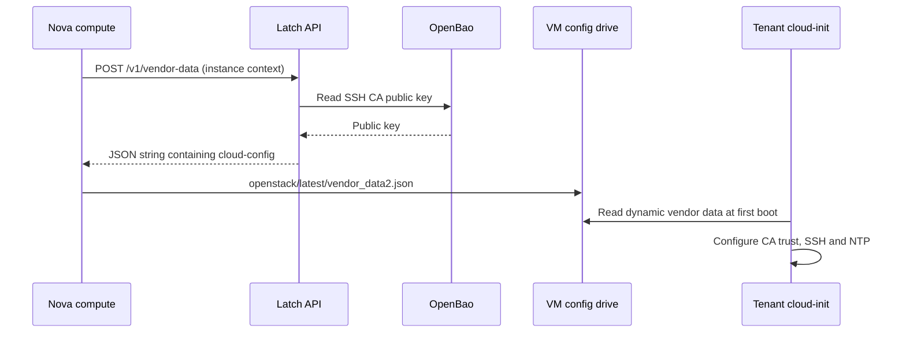

# Latch API and Nova DynamicJSON vendor data

> Historical record. This document describes its original implementation stage. See the [current documentation](../../README.md) for deployment and operating instructions.

Status: completed and live-validated on 2026-10-30. Management migrated with the existing OpenBao CA preserved; Nova DynamicJSON was validated with a separate fresh VM, no user data, correct CA and first-boot policy, successful/rejected certificate logins, fatal API/OpenBao outage behavior, recovery and profile snapshot checks. Disposable resources were removed and the original profile restored. Local evidence: `.state/dynamic-vm-validation.md`. The primary tenant was retained. Its replacement remains a separate decision described in [cutover/rollback](../../guides/vendor-data-cutover.md).

This document retains the completed implementation's design and acceptance criteria. Its references to Boundary describe the gateway used during those historical checks. The subsequent [Warpgate migration](../warpgate-migration.md) replaces Boundary controller/worker/database with one agentless SSH gateway; it has its own acceptance checklist.

## Intended outcome

Create a Latch API application whose first capability provides Nova dynamic vendor data. New tenant VMs receive the OpenBao SSH user CA public key and platform configuration without user data or a static Nova vendor-data file.

The application is a separate container, alongside OpenBao, Boundary controller, worker and PostgreSQL. Keep its HTTP routes, configuration policy, cloud-config rendering and OpenBao client separate within one small application. This permits future Latch endpoints without creating a vendor-data-only service or introducing speculative features.

The existing tenant uses its original user-data config drive. This implementation supersedes the partially applied StaticJSON approach for new builds while preserving that tenant and its disk. Validate DynamicJSON on a separate disposable VM before any cutover decision.

## Request flow



Nova calls the application, rather than the tenant calling Latch directly. DynamicJSON supports config drives and the metadata service. Its targets receive POST requests with project, instance, image, hostname, metadata and user-data context, and its results are namespaced by target name. See [Nova vendor-data documentation](https://docs.openstack.org/nova/latest/admin/vendordata.html).

Use target name `cloud-init`. The endpoint returns a JSON-encoded string containing `#cloud-config`, so Nova produces `{"cloud-init":"#cloud-config\n..."}` in `vendor_data2.json`. Returning a second `cloud-init` wrapper would produce the wrong nesting. Verify this contract against the installed Nova and tenant cloud-init versions before wiring it into provisioning. [Nova provider source](https://github.com/openstack/nova/blob/master/nova/api/metadata/vendordata_dynamic.py), [cloud-init vendor-data handling](https://docs.cloud-init.io/en/latest/reference/datasources/openstack.html#vendor-data).

## Application and network design

- Application: `latch-api`; Python/FastAPI application served by Uvicorn, with pinned dependencies and an ARM64-compatible image. No application database is necessary for this first capability.
- Routes: `POST /v1/vendor-data`, `GET /health/live`, and `GET /health/ready`. An optional public-CA inspection endpoint can be added only if needed by operator workflows.
- Docker network: `management`, configured and live as `10.1.3.0/24`, gateway `10.1.3.254`; migration from `172.20.1.0/24` completed before Latch API deployment. Latch accesses OpenBao using its Docker service name, `openbao:8200`.
- Nova access on the primary Lima backend: publish Latch port 8300 on the Linux host's `127.0.0.1`. This is inside Lima, without a new laptop port forward. No tenant/provider/control/database network attachment is needed.
- Preserve the separate Boundary, OpenBao and database containers and their current network assignments.
- Initial scope is the active Lima backend. Document the legacy backend as unsupported for this capability until its separate host-to-container route is implemented and tested; do not silently configure it with Lima's loopback URL.

## API behavior and trust

Validate the Nova request with a typed model. Require well-formed instance and project identifiers; tolerate documented optional fields and additional Nova fields. Ignore user data as a source of policy. Initially apply one operator-configured lab profile; do not treat tenant-supplied metadata as permission to choose privileged configuration or arbitrary file paths.

Fetch `/v1/ssh-client-signer/public_key` from OpenBao, after verifying the exact endpoint and response contract against the installed version. The application needs no OpenBao root token, signing permission, private key or shared access to OpenBao's data volume. Validate the returned SSH public key, and return an error if it is missing, malformed or unavailable. The object installed into the guest is an SSH CA public key, rather than an X.509 CA certificate.

Render the existing SSH trust and authentication settings and local NTP configuration into cloud-config. Record a schema/profile revision inside the VM so operators can identify the applied configuration. Return no secrets and do not log request user data, tokens or full response bodies. Log instance ID, profile revision, CA fingerprint, latency and outcome.

For the local POC, the API is confined to Docker management and Linux loopback. This assumes trusted access to the lab host and management network; network placement alone does not authenticate Nova. Before exposing Latch to a broader network, add TLS and Nova's supported Keystone service-token validation. This does not require external identity-provider authentication. Do not invent a bearer-header scheme that Nova's provider cannot send.

## Nova configuration and failure behavior

Settings for the installed release:

```ini
[api]
vendordata_providers = StaticJSON,DynamicJSON
vendordata_dynamic_targets = cloud-init@http://127.0.0.1:8300/v1/vendor-data
vendordata_dynamic_connect_timeout = 3
vendordata_dynamic_read_timeout = 5
vendordata_dynamic_failure_fatal = true
```

Apply to the actual configuration file read by each service: this DevStack deployment uses `nova-cpu.conf` for nova-compute config drives and `nova.conf` for the metadata API. Inspect service command lines rather than assuming every service reads `nova.conf`. Preserve protected originals for both services; update only the intended options and restart affected services only as necessary.

Nova stable/2025.2 config-drive generation enumerates the legacy `vendor_data.json` entry as well as `vendor_data2.json`. Retain `StaticJSON` with no `vendordata_jsonfile_path`, producing only an empty `{}` for that compatibility entry; remove the old static CA file path. All CA and platform configuration comes from Latch through `DynamicJSON` in `vendor_data2.json`, and dynamic delivery failures remain fatal. This empty compatibility provider does not provide a fallback CA or platform configuration. Stop submitting user data. See [Nova stable/2025.2 configuration source](https://github.com/openstack/nova/blob/stable/2025.2/nova/conf/api.py) and [metadata/config-drive source](https://github.com/openstack/nova/blob/stable/2025.2/nova/api/metadata/base.py).

Set a smaller bounded OpenBao request budget within Nova's read timeout. Use explicit non-2xx errors for invalid requests, upstream failures or invalid CA data; never return an empty successful configuration on those paths. Readiness checks require a usable CA. Provisioning must check readiness before requesting a new server. Repeated requests must be safe and have no provisioning side effects.

Dynamic generation does not mean continuous guest configuration. With a config drive, the generated result is a snapshot created during server build. Existing VMs and ordinary reboots will not automatically receive CA rotations or profile changes. A later phase could add metadata-service delivery or a guest refresh mechanism, with a separate rotation policy; neither is required for this first implementation.

## Implementation stages and acceptance criteria

### 1. Verify the integration contract

Read installed Nova DynamicJSON and image cloud-init code without changing the live tenant. Confirm target wrapping, JSON-string support, request fields, OpenBao public endpoint, config-drive ingestion and fatal-error behavior.

Acceptance: checked fixtures document the exact POST and final `vendor_data2.json`; the installed cloud-init parser accepts the generated payload. If it does not, resolve the image compatibility issue before deployment, without silently falling back to user data.

### 2. Build the first Latch API capability

Add the application, Docker image, typed request model, profile renderer and public-only OpenBao client. Reuse the existing cloud-config policy rather than maintaining separate SSH/NTP copies.

Acceptance: API tests cover a valid request, malformed identifiers, unknown fields, non-authoritative metadata, malformed CA, OpenBao outage/timeouts and repeated requests. Confirm no OpenBao credential or private key is required. Test the actual JSON response type and final Nova wrapping.

### 3. Wire the container and Nova configuration

Add `latch-api` to the Lima Compose stack, source synchronization and lifecycle handling. Add readiness checks and targeted DynamicJSON configuration. Replace the paused StaticJSON path and laptop-to-host CA copying for provisioning, while keeping normal laptop certificate issuance intact.

Acceptance: Nova on the Linux host reaches Latch, Latch reaches OpenBao, the API is not published on the laptop or provider network, a repeated provision does not rewrite unrelated Nova settings, and existing Boundary/OpenBao workflows remain functional. Legacy commands fail clearly if this unsupported feature is selected.

### 4. Validate a disposable VM without replacing the current tenant

Create a separately named test VM and unused tenant port with no user data. Use a temporary, explicit forwarding/Boundary test target if needed; retain the existing target and VM throughout the test.

Acceptance: mount its config drive and inspect `openstack/latest/vendor_data2.json`; demonstrate absent/empty user data; match the installed CA fingerprint with OpenBao; verify cloud-init completion, SSH policy and NTP; prove certificate SSH through Boundary and rejection of unsigned keys, wrong principals and expired certificates. Record the API request for that VM.

### 5. Exercise failure and lifecycle behavior

Use disposable resources to test Latch unavailable, OpenBao unavailable, malformed responses and restart recovery. Restore services after each case. Change a harmless profile revision between builds to demonstrate fresh API generation and the unchanged snapshot in an existing VM. Never rotate the real CA merely to test the API.

Acceptance: failed delivery prevents the disposable server from becoming a successfully configured target, produces actionable logs, and never exposes fallback access. Existing VM connectivity remains available during API outages. Successful provisioning resumes after recovery.

### 6. Document and prepare an explicit migration

Update README, infrastructure documentation and architecture diagram with Latch API, network placement, API contract, inspection commands and snapshot limitations. The [cutover/rollback procedure](../../guides/vendor-data-cutover.md) is prepared for review: it preserves the old VM and its disk, creates a replacement, validates it and then switches forwarding. Account for the replacement SSH host key explicitly.

Acceptance: no current tenant is replaced during implementation or validation without a separate cutover decision. The rollback procedure restores the previous Nova provider configuration and forwarding without deleting the old disk. Final verification reports API checks, real VM checks and any limitations separately.

## Expected repository areas

- `latch_api/` application package and `containers/Dockerfile.latch-api`.
- `compose.lima.yaml`, `scripts/lima_backend.py`, and `scripts/lab.py` for container lifecycle and provisioning.
- `guest/vendor-data-configure.sh`, `guest/provision.sh`, and `guest/target-cloud-init.py` for provider configuration and rendering reuse.
- API/contract tests and disposable-VM validation tooling.
- `docs/getting-started.md`, `docs/architecture/infrastructure.md`, and `docs/architecture/render_diagrams.py` and its generated SVGs.

Implementation is authorized. Existing-tenant replacement and cutover require a separate decision after disposable-VM validation.


## Service management subnet migration

Status: completed on live Lima on 2026-10-30. Management is `10.1.3.0/24`, gateway `10.1.3.254`; OpenBao retained volume `latch-poc_openbao` and CA fingerprint `SHA256:FLZ2zQC5ICf8oDYnHMqMU2nPurJD6OaISF3SWXsbp6I`. Cold backup and resolved rollback configuration were retained. All Compose services became healthy and `./lab verify` passed, including certificate issuance and the existing tenant path. The legacy backend's configuration was updated without recreating its inactive resources. Disposable-VM DynamicJSON delivery and failure/recovery acceptance subsequently completed; see the status above.

Move only service management from `172.20.1.0/24` to `10.1.3.0/24`, using gateway `10.1.3.254`. Boundary control stays `10.1.1.0/24`; database stays `10.1.2.0/24`; OpenStack management stays `172.20.2.0/24`. Provider and tenant networks also stay unchanged. OpenBao retains its service name, published API port and persistent data volume. Deploy Latch API on the migrated management network.

1. **Inventory and overlap check.** Inspect laptop LAN/VPN routes, Linux host routes, existing network IPAM, attached services and explicit references to the old subnet. Confirm `10.1.3.0/24` has no conflicting route. Identify whether the legacy backend is active before touching its separate networks. Record OpenBao health, the CA fingerprint, current network settings and the exact persistent volume identity. Prepare a protected backup using the existing recovery mechanism; keep CA recovery material out of logs and version control.
2. **Prepare configuration.** Update the management IPAM subnet/gateway in both Compose definitions for consistent defaults. Update relevant validation expectations and documentation, keeping addresses service-discovered rather than hardcoding OpenBao's container IP. Review generated Compose configuration for both backends. Do not recreate inactive legacy resources merely to update their defaults.
3. **Migrate the active management network.** Schedule a brief certificate-signing interruption. Stop and remove only services attached to that network while retaining their named volumes. Verify the network has no remaining attachments before replacing it with the new IPAM settings and recreating those services. Docker network subnets cannot be edited in place. Avoid a whole-stack teardown, volume removal or unrelated network recreation. If unexpected attachments exist, inventory them before proceeding.
4. **Verify recovery.** Confirm subnet `10.1.3.0/24` and gateway `10.1.3.254`, service DNS resolution, OpenBao readiness and the unchanged CA fingerprint. Issue a fresh user certificate and run `./lab verify` through Boundary. Confirm existing controller/database/worker, provider forwarding and tenant connectivity remain healthy. Inspect service routes for accidental cross-network access changes. Record any expected signing interruption.
5. **Rollback if necessary.** Stop only migrated services, retain their volumes, restore the old Compose subnet/gateway and recreate the management network on `172.20.1.0/24`. Reattach services using the same data volumes; recheck the CA fingerprint, issuance and connectivity. Never solve a network migration failure by reinitializing OpenBao or generating a new CA.

Acceptance: only the management subnet changes; OpenBao retains the original CA and data; certificate issuance and complete connectivity verification pass; active-network rollback is documented. Keep live verification status explicit alongside the configured deployment diagram and tables until migration succeeds. This migration is a prerequisite for Latch API container deployment, but can be implemented and verified independently of DynamicJSON or tenant replacement.
