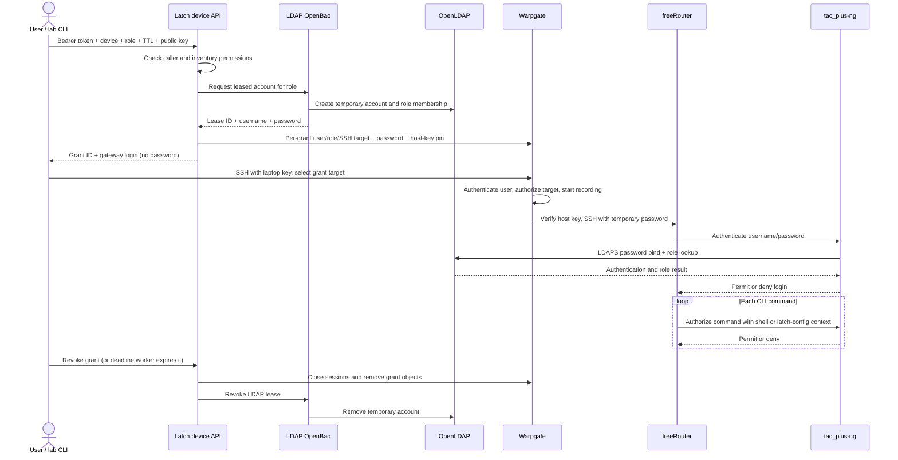
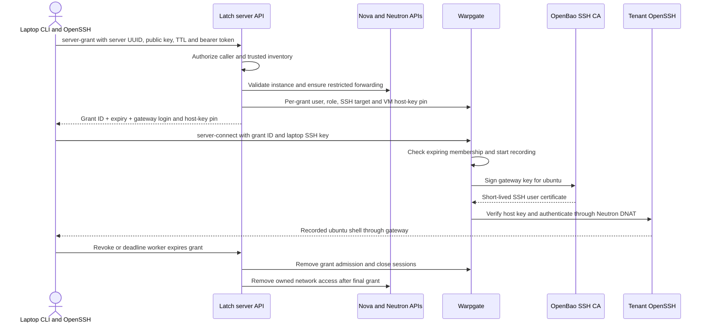

# Access workflows: network devices and servers

Both paths use agentless SSH through Warpgate. Network reachability, gateway
admission, target authentication and permission to run commands are separate
checks. This guide describes the implemented local POC; the three-role
network-device policy passed its complete live acceptance run. See the
[current validation status](network-device-lab.md#validation-status).

## Network-device access

Warpgate connects from management IP `10.1.3.10` to freeRouter at
`10.1.4.20:22` on the separate device-management subnet. The lab device-router
provides routing without NAT; freeRouter calls tac_plus-ng at `10.1.3.21:49`,
which uses LDAPS to OpenLDAP on service management `10.1.3.0/24`. The router publishes no laptop-facing port.
Network reachability is established by deployment, rather than by opening a
per-user firewall rule. A grant creates identity and authorization objects.

1. The administrator runs `./lab network-up`. It configures the directory,
   isolated LDAP OpenBao, device API, TACACS+ policy and router, and registers
   the router's persistent SSH host key in trusted inventory.
2. The user requests `./lab device-grant --device freertr --role readonly --ttl 300`.
   The CLI authenticates to the device API with the local POC bearer token,
   mapped by the server to `lab-operator`. The API checks both device inventory
   roles and this caller's permitted device/role combinations. A request body
   cannot select a different caller or override the trusted endpoint.
3. The API requests a unique leased LDAP account from isolated OpenBao. OpenBao
   creates its password and role-group membership in OpenLDAP. The API creates
   a per-grant Warpgate user, role and **SSH target**, registers the laptop's
   gateway public key, pins the device host key and supplies the leased password
   to Warpgate. The response contains grant metadata and a gateway login name;
   it does not expose the password to the laptop.
4. `./lab device-connect --grant GRANT_UUID` opens interactive SSH to Warpgate
   through laptop loopback port `9202`. Warpgate checks the laptop key and
   target-role assignment, verifies the router host key, starts recording and
   injects the temporary LDAP password into its separate SSH connection.
5. freeRouter asks TACACS+ to authenticate the temporary username/password.
   The LDAP helper validates the directory CA, binds as that user and requires
   exactly one recognized role group. No password cache or permissive local
   login fallback is configured.
6. For each CLI command, freeRouter separately requests TACACS+ authorization.
   Exec requests use `service=shell`; the pinned-source authorization patch
   labels actual configuration-mode requests `service=latch-config`.
   `readonly` permits operational inspection, diagnostics and outbound
   connections; `operator` adds all configuration-mode commands and saves;
   `admin` permits all commands. See the [full role policy](network-device-lab.md#logical-architecture)
   for command families and exclusions. Read-only `show running-config` can reveal
   sensitive configuration; this permission does not redact secrets. Operators
   can change AAA configuration,
   so their access is not a strict security boundary from administrator access.
7. Warpgate retains the terminal recording. `./lab device-revoke --grant GRANT_UUID`
   closes managed sessions, removes temporary gateway objects and revokes the
   LDAP lease. The requested grant lifetime is 1–300 seconds and is bounded by
   the actual lease lifetime. The two-second cleanup worker reconciles expired
   grants and pending cleanup, including after service restart. Gateway role
   expiry and LDAP lease expiry prevent new access; outages can delay forced
   closure of existing sessions until cleanup recovers.

The device API persists grant metadata in SQLite; Warpgate stores the target
password for the grant lifetime. Protect its storage, backups and recordings.
Revocation invalidates credentials but does not securely erase database pages
or backups. Full lifecycle details are in [device access](device-access.md).

## Server access

Latch coordinates server access through a separate server API container. Its API is
published on Linux-host loopback `127.0.0.1:8320`, with no laptop port forward.
The CLI calls it through the trusted Lima control channel. The vendor-data
application remains separate on port `8300`, with permission to read only the
public CA; it has no OpenStack or Warpgate administration credentials.

1. `./lab provision` prepares the tenant, floating IP and trusted VM inventory,
   deploys the server API and retires the old shared `latch` gateway login. The
   inventory binds the instance UUID to its project, port, fixed address,
   floating IP, SSH endpoint and independently collected host-key pin. New VMs
   receive the public CA and certificate-only SSH policy through Nova DynamicJSON
   vendor data on their config drive. The CA private key never leaves OpenBao.
2. `./server-grant --server SERVER_UUID --ttl 300` authenticates with the POC
   bearer token, mapped server-side to `lab-operator`. The API checks the caller's
   instance allowlist and accepts only the laptop's public SSH key and a lifetime
   of 1–300 seconds. Callers cannot choose a forwarding endpoint, host-key pin,
   Linux login or signing role.
3. The API validates the Nova instance and Neutron port/project ownership and
   checks that SSH security-group access permits only Warpgate's provider
   `100.64.10.10/32`. It ensures the inventory's Neutron forwarding rule:
   `100.64.10.120:22001` to tenant `192.168.20.15:22`. The floating IP has no full
   VM-port association. This path is shared by concurrent grants for that VM.
   Neutron API success can precede agent/data-path convergence; the live
   acceptance harness probes connectivity from Warpgate before SSH.
4. The API creates an isolated Warpgate user, role and certificate-backed **SSH
   target** for the grant. It registers the laptop public key, sets an expiring
   role membership and pins the VM host key. Recording and rejection of unknown
   host keys must be enabled. The response supplies a grant ID, expiry, gateway
   login and gateway host-key pin, without a private key or certificate.
5. `./server-connect --grant GRANT_UUID` authenticates to Warpgate with the laptop
   key and checks the gateway's host-key pin. Warpgate checks grant membership,
   selects the grant target, records the terminal and requests a five-minute
   `ubuntu` certificate from its restricted OpenBao signing backend. The target
   private key and issued certificate stay at Warpgate.
6. Warpgate verifies the VM host-key pin and establishes its own SSH connection
   through Neutron DNAT. The VM observes source `100.64.10.10`, validates the
   certificate against `/etc/ssh/latch-user-ca.pub` and opens an `ubuntu` shell.
   Server command authorization is the Linux account's existing permissions.
7. Explicit revoke or the API's deadline worker closes that grant's sessions
   and removes its gateway admission. Only after the last grant releases the VM
   does Latch remove its owned forwarding and security-group additions. Existing
   bootstrap security-group rules remain. The API persists grant intent in
   SQLite and retries incomplete cleanup, including after restart. A
   `cleanup_pending` response means revocation has not finished.

Issue a grant with `./server-grant`, then connect with
`./server-connect --grant GRANT_UUID`. Connecting requires the explicit grant ID
and never creates or automatically revokes a grant. Disconnecting leaves it
active until explicit revoke or expiry. `server-grant` remembers the current
grant for `./server-status` and `./server-revoke` without `--grant`.
These root entrypoints also work through `./lab server-grant`,
`./lab server-connect`, `./lab server-status` and `./lab server-revoke`.
See [command examples](../reference/commands.md#server-grants).

Server access includes physical hosts and VMs as a concept. The current trusted
inventory and network adapter supports OpenStack VMs; a physical-host backend
has not been implemented. The workflow below describes that deployed backend.

Warpgate removes an endpoint host-key pin when deleting an SSH target. To keep
another grant on the same endpoint usable, cleanup first detaches the revoked
target from its role and removes the grant user and role. It retains the disabled
target until final endpoint cleanup, then deletes these targets together. A
retained target has no grant admission and cannot be selected by another user.

Certificate expiry alone does not close established SSH sessions. The API worker
performs active termination; a worker outage can delay it until recovery, even
though Warpgate's expiring membership prevents new authorization. Recordings
remain available after temporary gateway objects are removed.

Server `readonly`, `operator` and `admin` roles remain a proposal. The agreed readonly
direction is a strict diagnostics interface, rather than an ordinary shell.
The current API permits only the baseline `ubuntu` login and has no server role
parameter. Network-device roles do not change server permissions.

The separate `./lab certificate` command remains a certificate-policy diagnostic;
its operator signing role has a 15-minute maximum. For API schemas and ReDoc,
see the [API reference](../reference/api.md).
