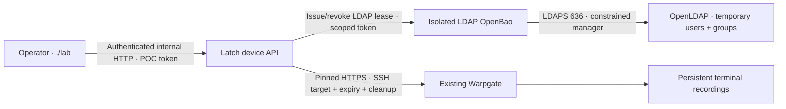

# Device access and credential lifecycle

The device API leases temporary LDAP credentials from an isolated OpenBao service and configures per-grant Warpgate SSH targets. The existing tenant VM continues to use its separate OpenBao SSH certificate path.

Use the [network-device lab guide](network-device-lab.md#build-and-use) to build
and start the optional services. This page explains credential custody, trusted
inventory, grant issuance and cleanup. The [access workflow](access-workflows.md#network-device-access)
shows how those pieces grant end-to-end access.

## Credential services

`network-up` starts the directory and device foundation: `openldap`, `ldap-openbao` and `device-api`. It preserves the existing SSH CA service. OpenLDAP and the isolated LDAP OpenBao have persistent volumes; the API stores grant metadata in its own SQLite volume. The external OpenBao LDAP plugin is pinned to `secrets-ldap-v0.1.0`, with architecture-specific SHA-256 verification. No optional device service publishes a host port. [OpenBao LDAP engine](https://openbao.org/docs/secrets/ldap/), [plugin release](https://github.com/openbao/openbao-plugins/releases/tag/secrets-ldap-v0.1.0).



The directory, LDAP OpenBao and device API use service management `10.1.3.0/24`. freeRouter SSH authenticates through tac_plus-ng against the temporary directory accounts. The separate vendor-data Latch API remains read-only with respect to OpenBao.

## Administrative identity and secret custody

Secrets are generated once in local `.state/lima/device/`, mode 0600, then securely copied into Lima `.state/device/`. Do not rotate these files by deleting them while persistent LDAP/Bao volumes exist. The POC uses a single fixed bearer token mapped by the server to `lab-operator`; it is not an enterprise identity integration. Internal HTTP for this API and isolated OpenBao is restricted to the private lab bridge and protected administration; use TLS and a real identity provider before deploying outside this POC. The device API runs as UID 10001 after copying private startup files into a temporary filesystem. It requires Warpgate administration rights for dynamic target management, so treat it as a privileged control service.

For existing labs, migration copies only known state files from the prior
directory when the destination file does not already exist. Existing Docker
backing volumes retain their old physical names solely to preserve data; the
logical service (`ldap-openbao`), Compose profile (`device`) and state directory
(`.state/device/` in Lima) use generic device-access names. No appliance
deployment is retained by this compatibility mapping.

## Trusted inventory and role eligibility

`network-up` registers freeRouter with its exported persistent host key. Trusted inventory is stored in `.state/lima/device/inventory.json` with an address, port, and **independently trusted** OpenSSH host public key:

```json
{
  "devices": {
    "freertr": {
      "host": "REPLACE_WITH_PRIVATE_DEVICE_ADDRESS",
      "port": 22,
      "host_public_key": "REPLACE_WITH_TRUSTED_OPENSSH_PUBLIC_KEY",
      "roles": ["readonly", "operator", "admin"]
    }
  },
  "permissions": {"lab-operator": {"freertr": ["readonly", "operator", "admin"]}}
}
```

The device and caller role lists independently constrain issuance. `readonly`
permits operational diagnostics and outbound connections, `operator` adds all
configuration-mode commands and saves, and `admin` permits all commands. An
operator can change AAA configuration; this role is not a strict security
boundary from admin. See
the [command policy](network-device-lab.md#command-policy) for exclusions and
[current validation status](../validation/status.md) for tested coverage.

Run `./lab network-up` after changing inventory; it recreates the API as needed. Invalid host keys fail startup. Do not use `ssh-keyscan` output as the sole trust anchor. There is no request-body option to override the endpoint or caller identity.

## Grant issuance and connection

```sh
./lab device-grant --device freertr --role readonly --ttl 300
./lab device-connect --grant GRANT_UUID
./lab device-revoke --grant GRANT_UUID
```

Each grant leases a unique LDAP username/password, creates a dedicated Warpgate user/role/**SSH target**, and authorizes the laptop public key. Responses contain only grant metadata and the SSH gateway username. LDAP passwords never appear in CLI output or the API response. Warpgate injects the password on its outgoing SSH connection. The grant coordinator keeps only lease identifiers and metadata in SQLite. Warpgate persists the target credential during its lifetime: protect its storage, backups and recordings; revocation invalidates the password but is not secure erasure of database pages or backups.

## Expiry, revocation and recovery

Maximum access duration is five minutes. A two-second worker reconciles durable state on startup and periodically, closes gateway sessions, removes temporary gateway objects and revokes the LDAP lease. Failed cleanup remains pending and is retried. Warpgate role assignment also has an expiry. An API or gateway outage may delay forced closure of an already established session; role expiry prevents new access and LDAP lease expiry invalidates the credential, but neither alone terminates existing SSH sessions. Recovery must reconcile them. The service is single-process; do not run multiple workers against the same grant database. It refuses issuance if Warpgate recording or strict host-key checking is disabled, or a default role would grant unintended access.

## Verification scope

`network-verify` checks real LDAP password binds, group membership, password hashing, constrained manager/reader ACLs and explicit lease revocation before exercising device SSH and command policy. The offline suite also covers ownership checks, concurrent grant isolation, partial failures, durable restart cleanup, HTTP authentication and the expiry worker. See the [network-device guide](network-device-lab.md#command-policy) for command policy,
the [acceptance checklist](../validation/network-device-checklist.md) for required
evidence and the [current validation status](../validation/status.md) for results.
