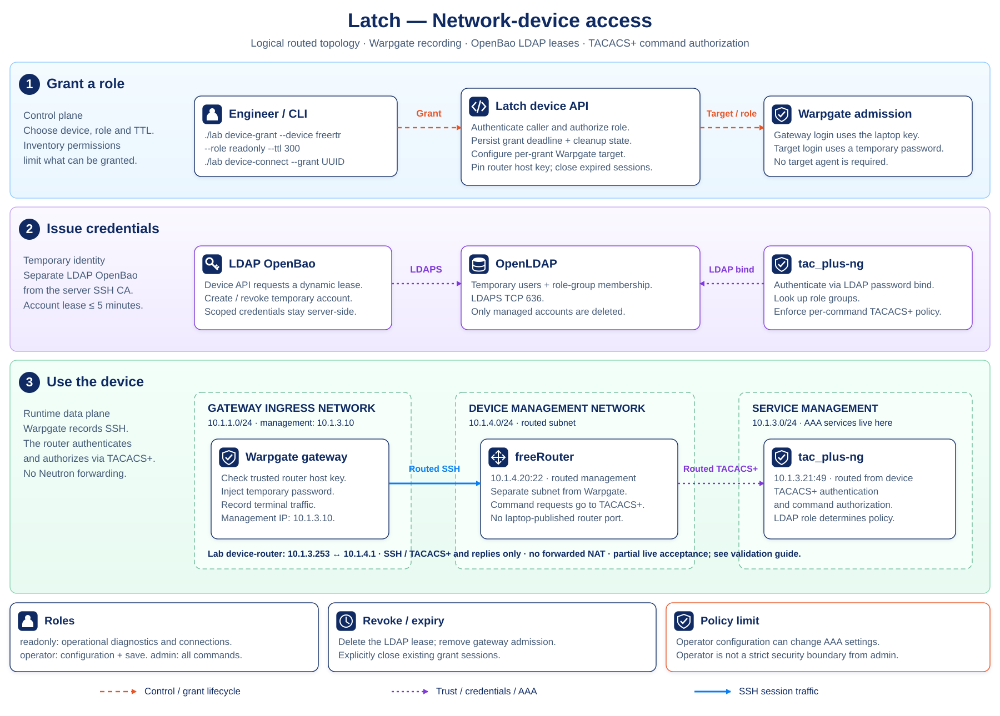
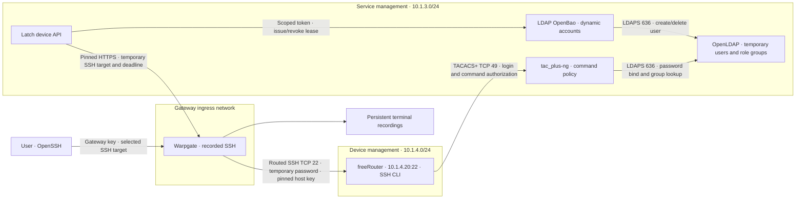

# Open source network-device lab

This optional path uses freeRouter as an SSH network device and tac_plus-ng
as its TACACS+ server. It reuses the existing OpenLDAP, isolated LDAP OpenBao,
Latch device API and Warpgate. No target agent is required.

## Build and use

With the Lima lab running and `./lab provision` completed:

```sh
./lab network-up
./lab network-verify
./lab device-grant --device freertr --role readonly --ttl 300
./lab device-connect --grant GRANT_UUID_FROM_PREVIOUS_COMMAND
./lab device-revoke --grant GRANT_UUID_FROM_PREVIOUS_COMMAND
```

Use `operator` or `admin` instead of `readonly` to request the corresponding
policy when your inventory permissions allow it. The grant
response contains metadata and a gateway login name, never the LDAP password.
Warpgate injects that password on the outbound SSH connection and checks the
device's pinned host key. The laptop continues to use its existing gateway key.
Use the interactive CLI opened by `device-connect`: the pinned freeRouter SSH
implementation ignores the payload of SSH remote `exec` requests.

`network-up` builds the optional containers, starts the directory foundation,
registers the router host key through authenticated container administration,
and adds the `freertr` inventory entry. Other device entries are preserved.
Generated secrets remain under ignored `.state/lima/device/` on the laptop and
private `.state/device/` inside Lima. Existing service volumes must be preserved.

## Logical architecture





TACACS+, OpenLDAP, LDAP OpenBao and the device API belong to service management;
AAA is a service role, not a separate network type.

Warpgate reaches freeRouter at `10.1.4.20:22` from management IP `10.1.3.10`.
The device reaches tac_plus-ng at `10.1.3.21:49`; TACACS+ and LDAP remain on
service management. The path uses ordinary routing, without NAT or Neutron
floating-IP forwarding. It adds no laptop-published ports.

The optional `device-router` container has `10.1.3.253` on service management and
`10.1.4.1` on device management. Warpgate is not attached to the device subnet.
Static routes establish both request and return paths:

| Endpoint | Destination | Next hop |
| --- | --- | --- |
| Warpgate `10.1.3.10` | `10.1.4.0/24` | `10.1.3.253` |
| freeRouter `10.1.4.20` | `10.1.3.0/24` | `10.1.4.1` |
| TACACS+ `10.1.3.21` | `10.1.4.0/24` | `10.1.3.253` |

The lab router permits Warpgate-to-freeRouter TCP 22 and freeRouter-to-TACACS+
TCP 49, plus replies, and rejects other forwarded traffic. This router is lab
infrastructure; a deployed environment can supply the same routes and policy
through its existing network. Other service addresses remain dynamically
allocated. TACACS+ shared-secret protection is not TLS; keep this path private.

## Command policy

The LDAP account role determines the TACACS+ command policy:

| Role | Permitted commands | Denied commands |
| --- | --- | --- |
| `readonly` | Operational diagnostics and outbound connections: `show` (including `show running-config`), `ping`, `traceroute`, `mtr`, `telnet`, `ssh`, `whois`, `lookup`, `help`, `echo` and session navigation | Configuration, saving, reload, file operations, shell access, output `redirect`/`pastebin` and `record` options |
| `operator` | Everything in `readonly`, all actual configuration-mode commands, and `write`, `write memory` or `write terminal` | Standalone exec `sleep`, reload, shell and file operations; output `redirect`/`pastebin` and `record` options |
| `admin` | All commands | No command restriction within this role |

Read-only `show running-config` can expose sensitive router configuration;
this permission does not imply that secrets are redacted.

The policy lives in `config/network/tacacs.cfg`; changes require rebuilding the
TACACS image. Inventory and caller permissions must both allow the requested
role. SSH admission and permission to run each CLI command are separate checks.
No permissive local fallback is intended.

The pinned freeRouter build applies
`containers/freertr-authorization.patch` so configuration-mode TACACS+ requests
carry `service=latch-config`; exec requests retain `service=shell`. The
scoped configuration service accepts an optional empty `cmd-arg`, matching
freeRouter’s actual authorization requests. This lets
the server distinguish actual configuration commands from ambiguous bare exec
commands. `operator` can alter AAA through its unrestricted configuration
access, so its command policy is not a strict security boundary from `admin`.

Acceptance for this role model must prove read-only running-configuration
inspection and ping while denying configuration; an operator description
change with arbitrary test text and a save; and a harmless command available
only to the administrator. These checks use actual device output and recorded SSH sessions; see the
[acceptance checklist](../validation/network-device-checklist.md) and
[current validation status](../validation/status.md).

Access lasts at most five minutes. LDAP expiry blocks new authentication;
Latch's existing cleanup worker also closes Warpgate sessions and removes grant
objects. Removing an LDAP user alone does not terminate an established session.
Outages can delay session cleanup until the services recover. See the
[device lifecycle details](device-access.md) for persistent credential storage
and the local POC's administrative trust assumptions.

The router uses an RSA 3072-bit host key retained in the `network-freertr`
volume. Startup exports its public key for inventory registration; a changed
existing pin is rejected. Runtime configuration is rebuilt from the repository
on restart, so interactive configuration changes are temporary. The router
has no configured local login fallback. The TACACS LDAP helper validates the
directory CA, binds with the supplied user password, and requires exactly one
recognized role group. No password cache is enabled.

## Build inputs

The Dockerfiles pin source archives and verify their SHA-256 checksums:

| Component | Source revision |
| --- | --- |
| freeRouter | `653030ace15e8dad869d55c26ad9895f676b8c35` |
| tac_plus-ng | `cdf4ab87040b2a5ee449584c6d6bfda899a996ae` |

The first build downloads Linux packages, a Java runtime and source archives.
Both images build natively on ARM64. This product includes software developed
by Marc Huber (Marc.Huber@web.de). Upstream licenses are retained in the images.

The freeRouter build applies `containers/freertr-timeouts.patch` with zero fuzz
before compilation. It bounds host-stack TCP connection attempts and TACACS+
command-response inactivity to five seconds each. The pinned upstream otherwise
uses the operating system's potentially lengthy TCP connect timeout and a
three-minute command-response timeout. This change makes loss of the TACACS+
server produce a timely authorization denial; it adds no local authentication
fallback. Both the timeout and authorization patches are retained in the image
alongside the upstream license.

## Stop and recover

```sh
./lab network-down
./lab network-up
```

The optional stop command preserves the router identity and directory volumes.
The existing tenant VM and certificate path remain separate. Re-run
`./lab verify` to verify that path after deployment.

## Validation status

See the [current validation status](../validation/status.md) for the latest
results and outstanding checks, the [acceptance checklist](../validation/network-device-checklist.md)
for required evidence, and [dated device reports](../validation/reports/network-device-history.md)
for historical run details and recording IDs.
